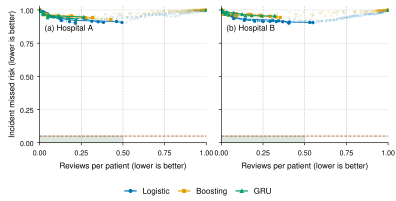

# Full-release incident-alert revision

Completed on 40,336 public patients. Run `d2efff2d-0525-47d7-ba94-879667d6b795`, commit `fbfaff0d73a96faf5d9d76764764fcd8321d27e4`.

## Design
All public A/B files are included. A is split 55/15/15/15% into train, validation, calibration and test; B has a separate 25% calibration reserve and 75% frozen test. Three seeds; validation tunes logistic regression, gradient boosting and a GRU. Training and primary AUROC exclude post-onset rows. Complete challenge utility is reported separately using the official evaluation implementation.
The incident endpoint requires the first alarm in [first positive label, inferred onset). Inferred onset is first positive label plus six hours. Initial-positive and onset-after-discharge patients are excluded from conditional incident risk, retained for review workload. This is an observable benchmark endpoint, not verified clinical onset. Patient-specific opt-out and hour-12 revocation are simulated; recurrent state is cleared at withdrawal.

## Main measurements
- boosting, hospital A: mean pre-onset AUROC 0.7944, AP 0.0596, Brier 0.0683.
- boosting, hospital B: mean pre-onset AUROC 0.7307, AP 0.0328, Brier 0.0415.
- gru, hospital A: mean pre-onset AUROC 0.7775, AP 0.0598, Brier 0.0596.
- gru, hospital B: mean pre-onset AUROC 0.7522, AP 0.0305, Brier 0.0439.
- logistic, hospital A: mean pre-onset AUROC 0.7449, AP 0.0493, Brier 0.1304.
- logistic, hospital B: mean pre-onset AUROC 0.6659, AP 0.0254, Brier 0.1529.

The plotted all-seed test Pareto frontier is descriptive, not a threshold-selection procedure. All candidate thresholds are frozen using validation data. The horizontal line is alpha=.05; vertical references are K=.25/.5/.75. Full seed-specific curves are in `frontiers.csv`.

## What is certified
`certificates.csv` reports joint upper bounds for conditional incident risk and review probability on a fixed threshold grid. Two-sided exact binomial intervals use tail delta/(4M), giving simultaneous coverage at least 1-delta=.95 under independent patient sampling within the target population. There is no monotonicity assumption. A policy is certified only when both upper bounds meet alpha=.05 and K. An empty certified set is UNDETERMINED unless every grid policy has a lower bound exceeding at least one target. That certificate rules out only this fixed grid, not every possible model or policy. A-to-B certificates have no asserted transfer guarantee.
Repeated-alert incident loss remains monotone; first-alert loss need not be. Lowering a threshold can consume the one permitted alert too early. The tests include a concrete counterexample. Ordinary monotone CRC must not be applied to that first-alert loss. This finite-grid certificate is an application of Learn then Test / simultaneous confidence bounds, not a claimed invention of joint risk control.

## Consent, site transfer and oversight
`consent.csv` gives opt-out and revocation cost curves. `groups.csv` allocates delta across four prespecified overlapping demographic groups. `calibration_draw_summary.csv` describes 200 repeated subsets for each available positive-calibration size; draws overlap and are not independent clinical experiments. `weighted_shift.csv` is an exploratory estimated-ratio weighted-CRC comparison for the monotone repeated-window policy, with clipped estimated ratios and no claimed finite-sample guarantee.
`../revision-audit/queues.csv` supersedes the original queue false-action classification and runs arrival/service/noisy-review/fatigue scenarios on the sepsis scores. Service and arrival rates are sensitivity parameters, not measured ward constants. End-to-end misses count timely completed true-positive reviews; false actions and waiting are separate. `graph_ensemble.csv` covers 500 random DAGs with 50–300 nodes; these broaden structural tests but remain simulated.

## Answer and boundaries
`feasibility.csv` makes the criteria explicit: positive challenge utility is a benchmark usefulness criterion; empirical risk and workload are separate from their confidence certificates. Consent/storage and review-path checks concern the modeled graph. Even an all-positive benchmark row would not establish actual clinician effectiveness or patient benefit. The theorem and counterexample sharpen what can be guaranteed; the data determine whether this policy/model family meets the declared targets.
Full MIMIC requires credentialed access and was not run. The sparse MIMIC demo and five-participant movement experiment are archived supplementary results, excluded from the revised main evidence. The manuscript contains the proofs and related-work positioning.

## Reproduce
Run `bash run_all.sh` with `configs/execution.json` set to revision. Source dependencies and protocols are pinned. Every model selection uses validation only; no test frontier is used for tuning. See provenance.json for the exact contract.

## Completed policy audit
The validation-selected policy audit is in `../revision-audit/`. It reports 36 operating policies with exact pointwise test-risk intervals and 972 corrected queue scenarios. For boosting in A, mean utility is 0.332, reviews per patient 0.193, and strict first-alert missed risk 0.960. Across its three overlapping test splits, 414 eligible incident observations receive an early first alert, 298 receive none before onset and 30 receive a first alert inside the window. This explains why positive challenge utility does not establish the strict incident target. No selected model/site/policy combination meets positive utility, risk at most .05 and reviews at most .5.
